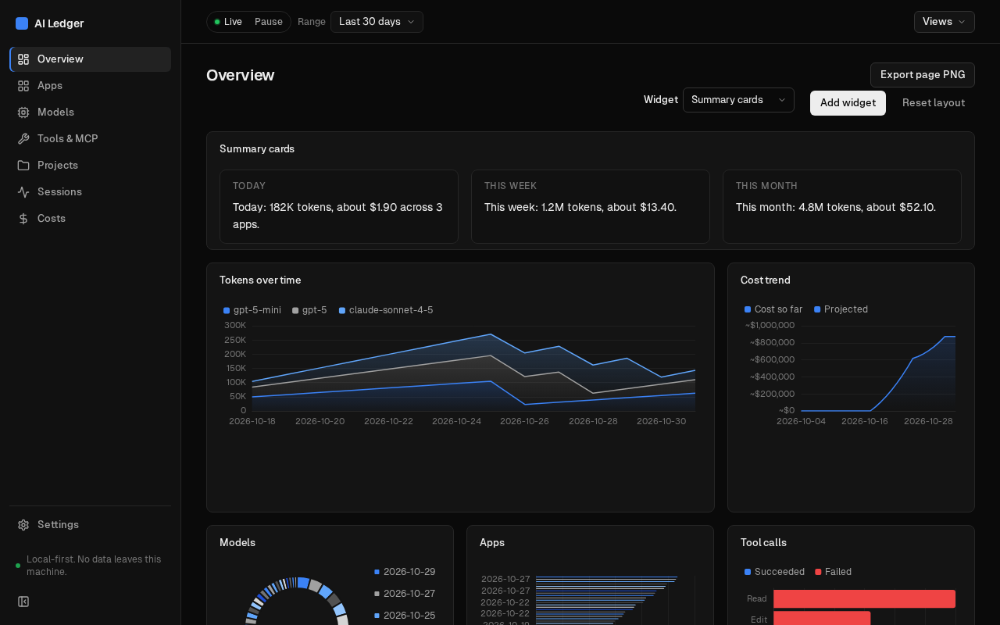
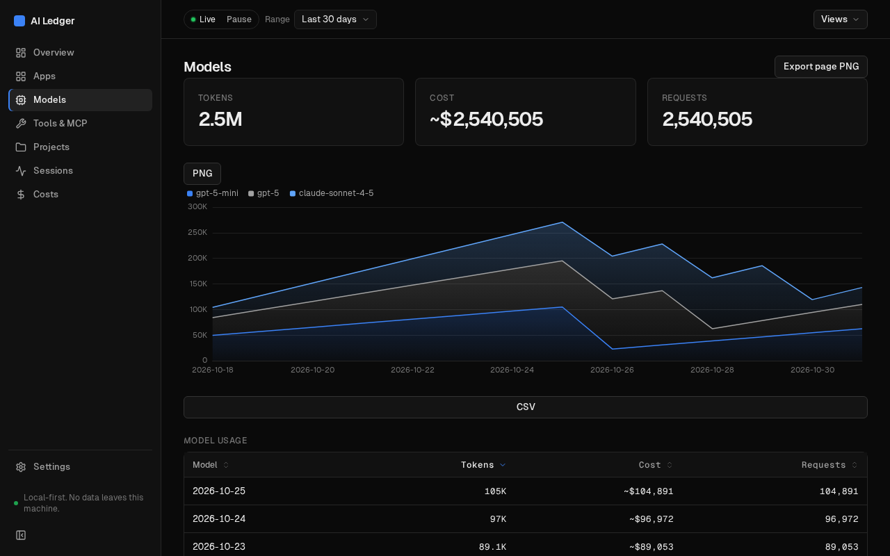
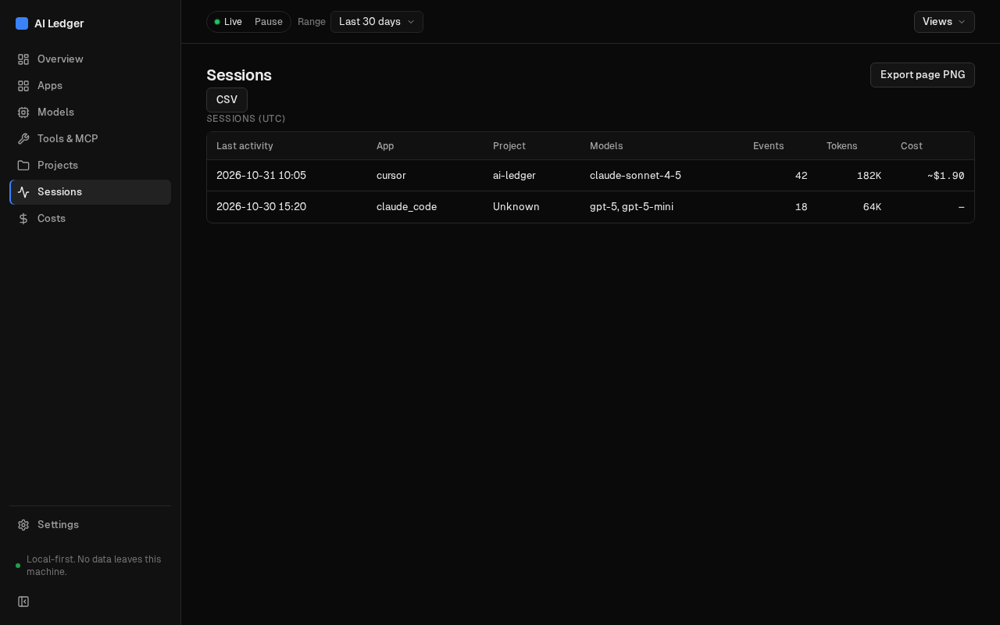
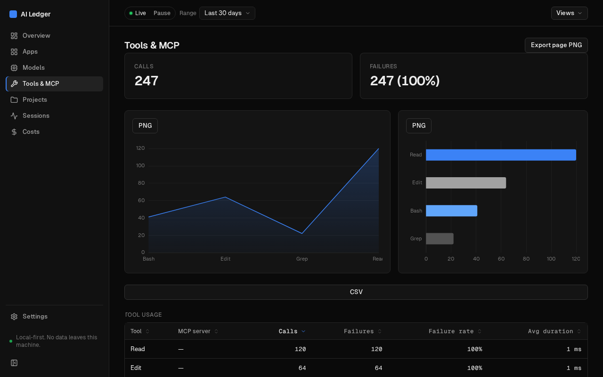
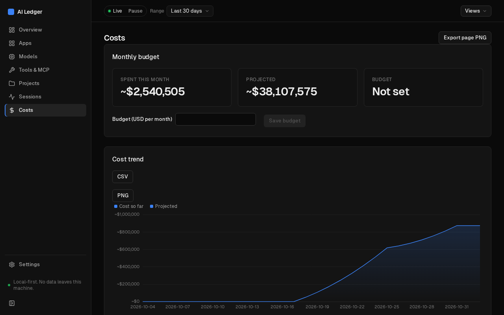

# AI Ledger

<p align="center"></p>

A local-first desktop app that records, aggregates, and visualizes AI usage
(tokens, estimated cost, requests, tool/MCP calls) across the AI apps on one
machine. Cursor is supported first.

Nothing leaves your machine: no telemetry, no cloud, no LLM calls.

## Screenshots

Shown with sample data.

| Models | Sessions |
| --- | --- |
|  |  |
| **Tools & MCP** | **Costs** |
|  |  |

## Install

There is no published release yet. Until there is, build it yourself or grab a CI artifact:

- **CI artifacts:** open a recent green run of the CI workflow on the Actions tab and download the bundle for your OS (kept for 7 days). Windows: `.msi` or `.exe`. Linux: `.AppImage`, `.deb` or `.rpm`.
- **From source:** `npm ci --prefix ui && ui/node_modules/.bin/tauri build`, run from the repo root (needs Rust and Node 22).

The builds are **unsigned**. Windows SmartScreen will warn; choose "More info" then "Run anyway". On macOS (local build only), right-click the app and choose Open. See [packaging](docs/packaging.md) for details.

## Status

Early development. See the [design spec](docs/superpowers/specs/2026-10-31-ai-ledger-design.md)
for the architecture and PR plan.

Guides: [user guide](docs/user-guide.md) · [writing a reader](docs/writing-a-reader.md) · [packaging](docs/packaging.md)

## Layout

```
src-tauri/            Tauri v2 shell (app, commands, tray, watcher)
crates/ledger-core/   storage, rollups, prices
crates/readers/       pluggable usage readers (cursor, claude_code, csv_import, proxy)
ui/                   React + TypeScript frontend
fixtures/             golden reader fixtures
docs/                 design and guides
```

## Development

```sh
cargo fmt --all --check
cargo clippy --workspace --all-targets -- -D warnings
cargo test --workspace
```

## License

MIT © 2026 Joel Shearon

### Running the app

Requires Node 20+ and the [Tauri v2 prerequisites](https://v2.tauri.app/start/prerequisites/).

```sh
npm --prefix ui ci
ui/node_modules/.bin/tauri dev   # from the repo root
```
